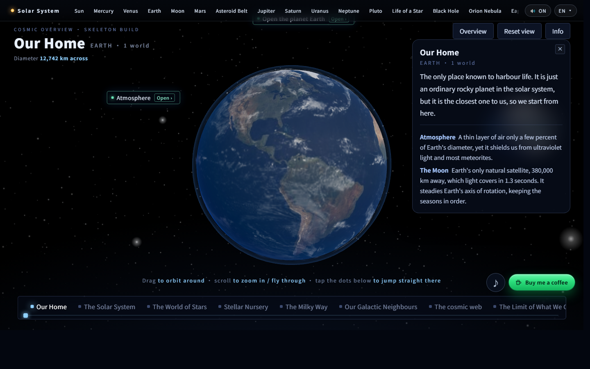
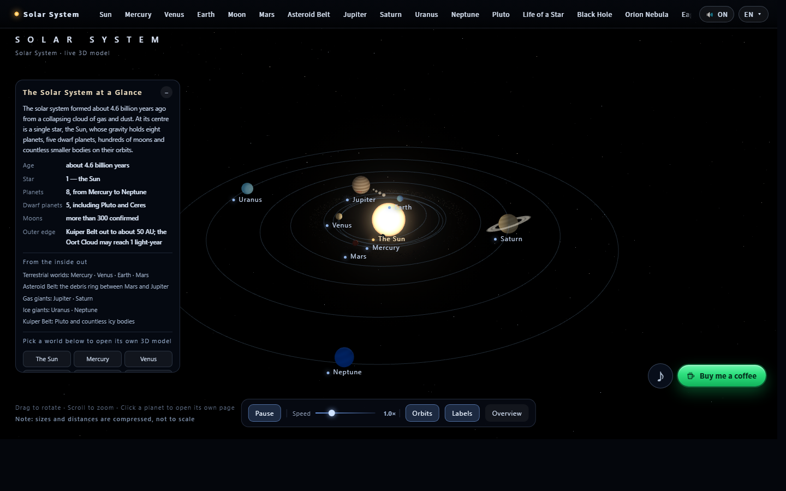
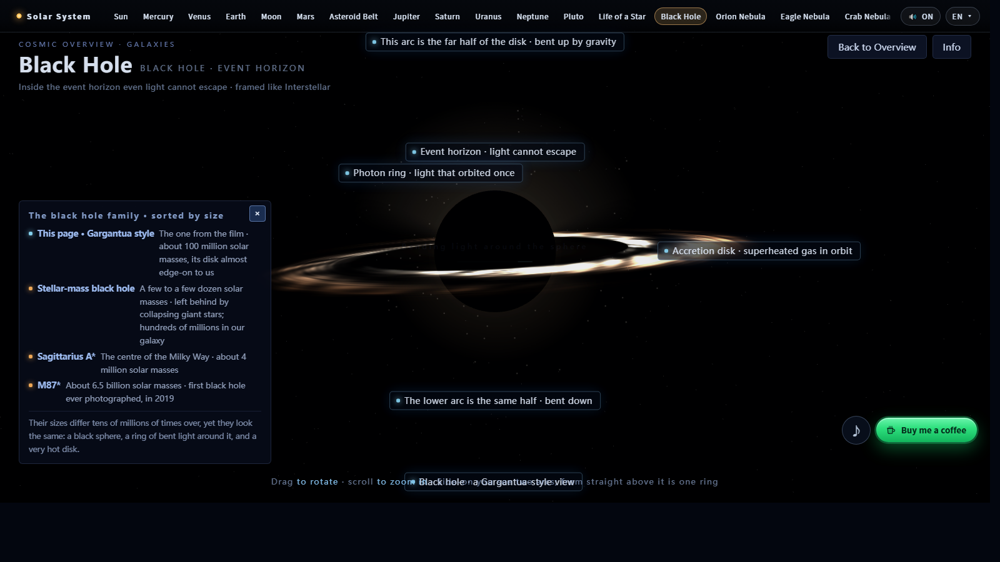

# 宇宙总览 · 3D 儿童宇宙科普站 / 3D Space for Kids

一个给孩子看的 3D 宇宙科普网站：23 个独立单文件页面，打开就能转、能缩、能点，没有构建步骤、没有服务器依赖。

A kid-friendly 3D space site: 23 standalone single-file pages. Drag to rotate, scroll to zoom, click a body to open its own page. No build step, no server needed.

**永久演示站 / Permanent live site（原始画质，由 GitHub Pages 托管）— <https://wendygreat.github.io/space-for-kids-3d/>**

**镜像演示站 / Mirror demo（压缩画质版）— <https://abc123.ct.ws/universe/>**

> GitHub Pages 这一版就是本仓库的原始画质版（贴图最高 4096px），打开即是首页，无需下载。
> The GitHub Pages site serves this repository as-is — the original-quality build with textures up to 4096 px.
>
> 另一个站是压缩画质版（行星贴图 1024px，为了过 1MB 单文件上限），页面与功能完全一致。
> The mirror runs the size-limited build (textures downscaled to 1024 px to fit a 1 MB per-file cap); pages and features are identical.


*首页 · 地球 · 宇宙总览第一站 / Home page*

---

## 目录 / Contents

- [这是什么 / What is this](#这是什么--what-is-this)
- [亮点 / Highlights](#亮点--highlights)
- [页面清单 / Pages](#页面清单--pages)
- [快速开始 / Quick start](#快速开始--quick-start)
- [部署到 GitHub Pages](#部署到-github-pages)
- [目录结构 / Structure](#目录结构--structure)
- [已知事项 / Notes](#已知事项--notes)
- [授权 / License](#授权--license)

---

## 这是什么 / What is this

**中文**

给小学生看的宇宙科普站。23 个页面，每个都是一份独立的 `.html` 文件，里面用 Three.js 实时渲染一颗天体：太阳系全景、八大行星与月球、冥王星、小行星带、恒星的一生、黑洞、四个星云、三个星系，以及一个可以顺着「地球 → 太阳系 → 恒星世界 → 星云摇篮 → 银河系 → 本星系群 → 宇宙网」一路走下去的宇宙总览。

每页都带：8 种语言的完整翻译（英 / 中 / 繁 / 日 / 韩 / 西 / 法 / 德）、朗读开关（浏览器语音朗读页面要点）、背景音乐开关（可关，朗读时自动压低），以及可以拖动旋转、滚轮缩放、点击天体跳转的交互。

**English**

A space-science site for primary-school kids. 23 pages, each a single self-contained `.html` file that renders one celestial object in real time with Three.js: the solar system, the eight planets plus the Moon, Pluto, the asteroid belt, the life of a star, a black hole, four nebulae, three galaxies, and a guided "cosmic overview" journey from Earth all the way out to the cosmic web.

Every page ships with: a full translation in 8 languages (EN / ZH / ZH-TW / JA / KO / ES / FR / DE), a read-aloud toggle (browser speech synthesis), an ambient-music toggle (switchable off, ducks automatically while reading), and orbit/zoom/click-to-open interaction.

---

## 亮点 / Highlights

| | 中文 | English |
|---|---|---|
| 零依赖 | 每个页面自己包含全部代码与贴图，断网双击也能看 | Every page carries its own code and textures; double-click offline and it just works |
| 实时 3D | Three.js 实时渲染，可拖动旋转、滚轮缩放 | Real-time Three.js rendering, orbit and zoom freely |
| 8 语言 | 导航、正文、按钮、弹窗文案逐条翻译 | Navigation, body text, buttons and dialogs all translated |
| 朗读 | 用浏览器语音把页面要点念出来，省眼睛 | Reads key points aloud via the browser's speech engine |
| 背景音乐 | 原创合成的 95 秒无缝循环，可一键关闭 | Original 95-second seamless ambient loop, one-click off |
| 无障碍 | 键盘可操作、`prefers-reduced-motion` 尊重系统设置 | Keyboard operable, respects `prefers-reduced-motion` |
| 轻部署 | 纯静态，扔到任何空间就能跑，无需 Node、无需打包 | Pure static: drop it on any host, no Node, no bundler |
| 文件名 | 全英文小写，URL 干净，不会出现 `%E5%AE%87…` 乱码 | All-ASCII lowercase filenames, clean URLs, no percent-encoded garbage |

---

## 页面清单 / Pages

| 文件 File | 内容 Content |
|---|---|
| `index.html` | 宇宙总览（首页）/ Cosmic overview — home |
| `solar-system.html` | 太阳系全景 / The solar system |
| `sun.html` | 太阳 / The Sun |
| `mercury.html` | 水星 / Mercury |
| `venus.html` | 金星 / Venus |
| `earth.html` | 地球 / Earth |
| `moon.html` | 月球地形 / The Moon |
| `mars.html` | 火星 / Mars |
| `asteroid-belt.html` | 小行星带 / Asteroid belt |
| `jupiter.html` | 木星与伽利略卫星 / Jupiter and its moons |
| `saturn.html` | 土星与光环 / Saturn and its rings |
| `uranus.html` | 天王星 / Uranus |
| `neptune.html` | 海王星与海卫一 / Neptune and Triton |
| `pluto.html` | 冥王星与卡戎 / Pluto and Charon |
| `life-of-a-star.html` | 恒星的一生 / Life of a star |
| `black-hole.html` | 黑洞 / Black hole |
| `orion-nebula.html` | 猎户座大星云 M42 / Orion Nebula |
| `eagle-nebula.html` | 鹰状星云 M16 / Eagle Nebula |
| `ring-nebula.html` | 环状星云 M57 / Ring Nebula |
| `crab-nebula.html` | 蟹状星云 M1 / Crab Nebula |
| `andromeda.html` | 仙女座星系 M31 / Andromeda |
| `whirlpool.html` | 涡状星系 M51 / Whirlpool Galaxy |
| `sombrero.html` | 草帽星系 M104 / Sombrero Galaxy |
| `music-bg.mp3` | 背景音乐 / Ambient background track |


*太阳系 · 轨道、行星标签与底部控制 / The solar system*


*黑洞 · 吸积盘与光子环标注 / Black hole*

---

## 快速开始 / Quick start

**在线看 / Live demo**

直接打开 <https://wendygreat.github.io/space-for-kids-3d/>（原始画质，GitHub Pages 永久托管），或 <https://abc123.ct.ws/universe/>（压缩画质镜像）—— 无需下载，浏览器即可体验全站。

**本地看 / Locally**

1. 下载整个仓库（`Code` → `Download ZIP`）并解压。
2. 双击 `index.html`，或直接拖进浏览器。
3. 想让访客默认看到中文：在网址后加 `?lang=zh`（默认是英文）。

**放在服务器上 / On a web host**

把 24 个文件（23 个 `.html` + `music-bg.mp3`）原样传到网站根目录即可，`index.html` 会自动作为首页。

Upload all files to the site root as-is; `index.html` is served as the home page automatically.

---

## 部署到 GitHub Pages

1. 把本仓库推到 GitHub。
2. `Settings` → `Pages` → `Source` 选 `Deploy from a branch`，分支 `main`、目录 `/ (root)`，保存。
3. 一两分钟后访问 `https://<你的用户名>.github.io/<仓库名>/`。

注意：本项目是纯静态文件，不需要 Actions、不需要构建。

> 本仓库是**原始画质版**（行星贴图最大 4096px，单页最大约 2.9MB）。GitHub Pages 不限单文件 1MB，因此这一版可以直接上线，画质最好。

---

## 目录结构 / Structure

```
.
├── index.html               # 首页 / home
├── *.html                   # 22 个专题页 / 22 topic pages
├── music-bg.mp3             # 背景音乐，必须与 html 同目录 / must sit beside the html files
├── screenshot-*.png         # README 用截图 / screenshots for this README
├── social-preview.png       # GitHub 社交预览图 / social preview (1280×640)
└── README.md
```

---

## 已知事项 / Notes

- **两个版本 / Two builds**：线上演示 <https://abc123.ct.ws/universe/> 是压缩版（贴图 1024px，为了过 1MB 单文件限制，画面略柔）；本仓库是原始画质版。两者页面、功能、链接完全一致，只有贴图清晰度不同。

- **音乐文件位置**：`music-bg.mp3` 必须和 `.html` 放在同一层，页面用的是相对路径。搬到子目录时整包搬，别只搬 html。
- **1MB 上传限制**：有些虚拟主机限制单文件 1MB。若遇到，需要把行星贴图降到 1024px 宽并转 JPEG（同一套页面，画质会柔一些，但还在 1MB 内）。
  *Some shared hosts cap a single file at 1 MB. In that case downscale the planet textures to 1024 px wide and re-encode as JPEG.*
- **捐款入口**：页面右下角的「请我喝一杯咖啡 / Buy me a coffee」弹窗指向作者本人的收款码。**二次分发或改版时请替换成你自己的，或直接删掉这一段**（在每页 `<!--SY_DONATE_START-->` 到 `<!--SY_DONATE_END-->` 之间）。
- **文件名**：一律英文小写。不要改成中文名，否则在部分服务器上会出现 URL 编码导致的 404。
- **浏览器**：建议 Chrome / Edge / Safari / Firefox 近两年版本；3D 部分需要 WebGL。
- **贴图来源**：页面里的行星与深空图像为内嵌位图，来源请以原素材说明为准（若为 NASA 公开影像，遵循 NASA 影像使用条款）。
- **本 README 的截图**拍摄于 1440×900 / 1600×900 的桌面浏览器。

---

## 授权 / License

- 页面代码、文案、音乐：**CC BY-NC-SA 4.0**（署名—非商业—相同方式共享）。详见 [LICENSE](LICENSE)。
- 行星与深空贴图：版权归属原始素材提供方，请在使用前自行确认其授权条款。

- Code, copy and music: **CC BY-NC-SA 4.0** — see [LICENSE](LICENSE).
- Planetary and deep-space imagery belongs to its original providers; check their terms before reuse.

如果你希望更宽松（例如允许商业使用），把 LICENSE 换成 MIT / CC BY 4.0 即可。

---

## 致谢 / Credits

- [Three.js](https://threejs.org/) — 3D 渲染 / real-time 3D rendering
- 浏览器的 Web Speech API 与 Web Audio — 朗读与音乐播放 / speech and audio playback
- 以及每一个愿意抬头看星星的孩子。 / And every kid who still looks up.

